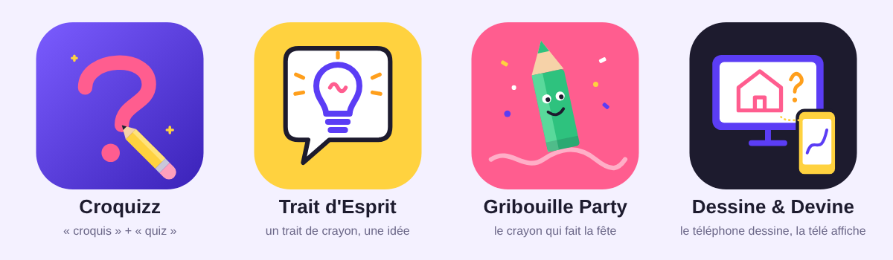

# 🎨 Croquizz : dessine, devine, gagne !

Jeu de dessin et de devinettes à plusieurs : **chaque téléphone sert de manette**, **la télé affiche le dessin en direct**.



## Comment lancer le jeu

1. Installez **Node.js** (version 18 ou plus) depuis https://nodejs.org (bouton « LTS »). Rien d'autre à installer.
2. Téléchargez ce dossier (bouton vert **Code** → **Download ZIP**), puis décompressez-le.
3. Ouvrez un terminal dans le dossier et tapez :
   ```
   node server.js
   ```
4. Le terminal affiche deux adresses, par exemple :
   - 📺 **Télé** : `http://192.168.1.20:3000/tv` → à ouvrir sur la télé (navigateur de la TV, ou l'ordinateur branché en HDMI, ou un onglet Chrome « caster » vers le Chromecast).
   - 📱 **Téléphones** : `http://192.168.1.20:3000` → ou scannez le QR code affiché sur la télé.
5. Tout le monde doit être sur **le même Wi-Fi** que l'ordinateur.

## Déroulement d'une partie

1. Chacun entre son prénom et choisit un avatar. Le premier arrivé est **l'hôte** : il choisit le thème et le nombre de tours, puis lance la partie.
2. Le dessinateur reçoit **3 mots** : 🟢 facile (100 pts), 🟠 moyen (200 pts), 🔴 difficile (300 pts).
3. Il dessine sur son téléphone, le dessin apparaît **en direct** sur la télé. Il a 90 secondes.
4. Les autres tapent leurs réponses sur leur téléphone (« 🔥 presque ! » quand c'est très proche). On peut aussi répondre à voix haute : le dessinateur touche alors le nom du joueur pour lui donner les points.
5. Le dessinateur appuie sur **✋ Fin de manche** : le mot est révélé sur la télé avec les points gagnés.
6. À la fin : **podium** avec confettis 🏆.

### Les points
- Trouver le mot : points du niveau + **bonus de rapidité** (jusqu'à +100) + **+50 pour le premier**.
- Le dessinateur gagne la moitié des points du niveau pour chaque joueur qui trouve.
- 💡 Une lettre est révélée à mi-temps (et une deuxième à 25 s de la fin pour les mots longs).

## Ajouter des mots ou des thèmes
Ouvrez `mots.js` avec un éditeur de texte (Bloc-notes suffit) et ajoutez des mots entre guillemets.

## Installer l'appli sur le téléphone (PWA)
L'appli a son icône, son nom et s'ouvre en plein écran.
- **iPhone** : dans Safari, bouton Partager → « Sur l'écran d'accueil ».
- **Android** : menu ⋮ de Chrome → « Ajouter à l'écran d'accueil ».

⚠️ L'installation « complète » (hors ligne, bouton Installer automatique) exige une adresse sécurisée en **https**. Sur le Wi-Fi de la maison (http), le téléphone crée un raccourci qui fonctionne très bien. Pour la vraie installation, il faudra mettre le jeu en ligne (étape suivante).

## Fichiers
| Fichier | Rôle |
|---|---|
| `server.js` | le serveur : relie téléphones et télé en temps réel (WebSocket, sans aucune dépendance) |
| `mots.js` | les listes de mots par thème et difficulté |
| `public/index.html`, `telephone.js` | l'écran du téléphone |
| `public/tv.html`, `tv.js` | l'écran de la télé |
| `public/manifest.webmanifest`, `sw.js`, `icons/` | l'installation sur téléphone (PWA) |
| `logos/` | les 4 propositions de logo |

`public/qrcode.js` : bibliothèque QR Code de Kazuhiko Arase (licence MIT).
